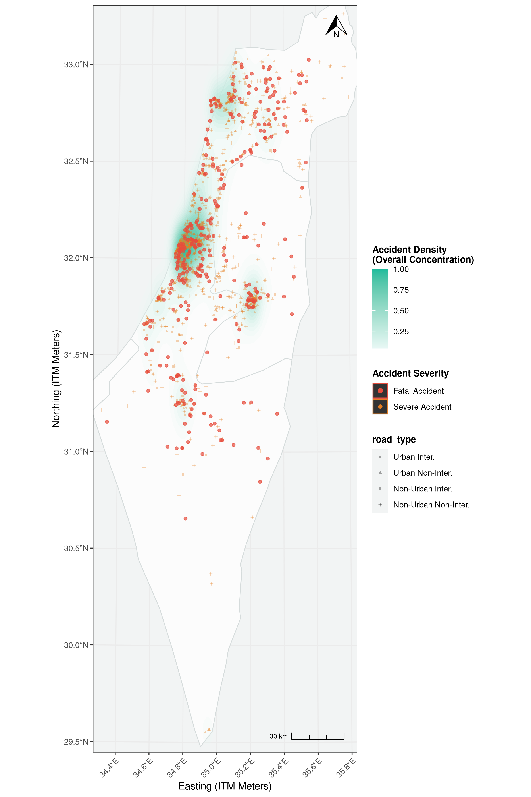

# Statistical Theory - Analysis on Car Accidents

This repository serves for the submission of the final project in the statistical theory course (868877501)

  

For the full article and conclusions, [the final report is available](https://github.com/GiladMi/stat-theory-project/blob/master/assets/Report.pdf)

## Build Instruction

### Prerequisites
* [**R**](https://www.r-project.org/) (version 4.0 or higher recommended)
* [**RStudio**](https://posit.co/downloads) (optional, but highly recommended)

### Setup and Execution
1. Clone and navigate to the repository.
2. In the R console, run `renv::restore()` to install the missing packages.
3. Run `scripts/main.R` (using the source button) to execute all of the scripts sequentially.
4. Results and summary are output directly to the console; plots will be written to the `plots/` directory.
